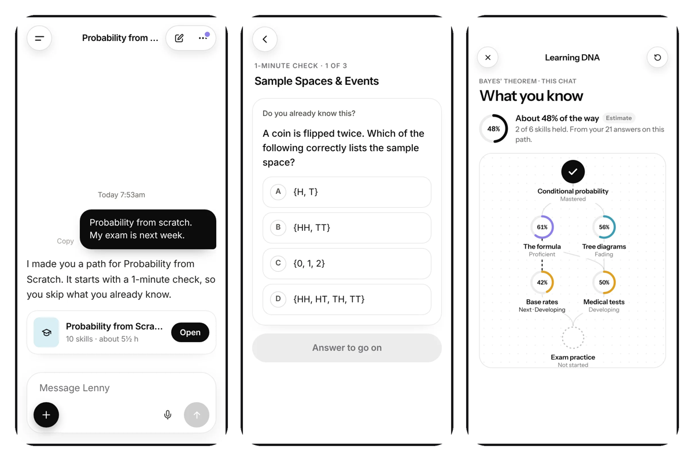
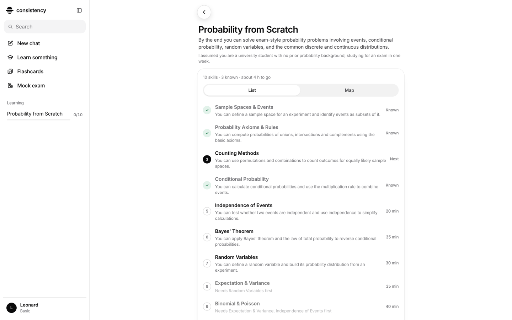
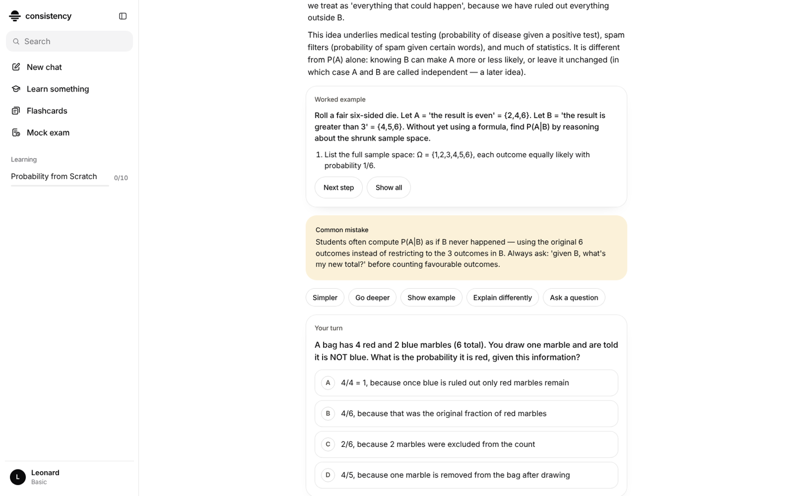
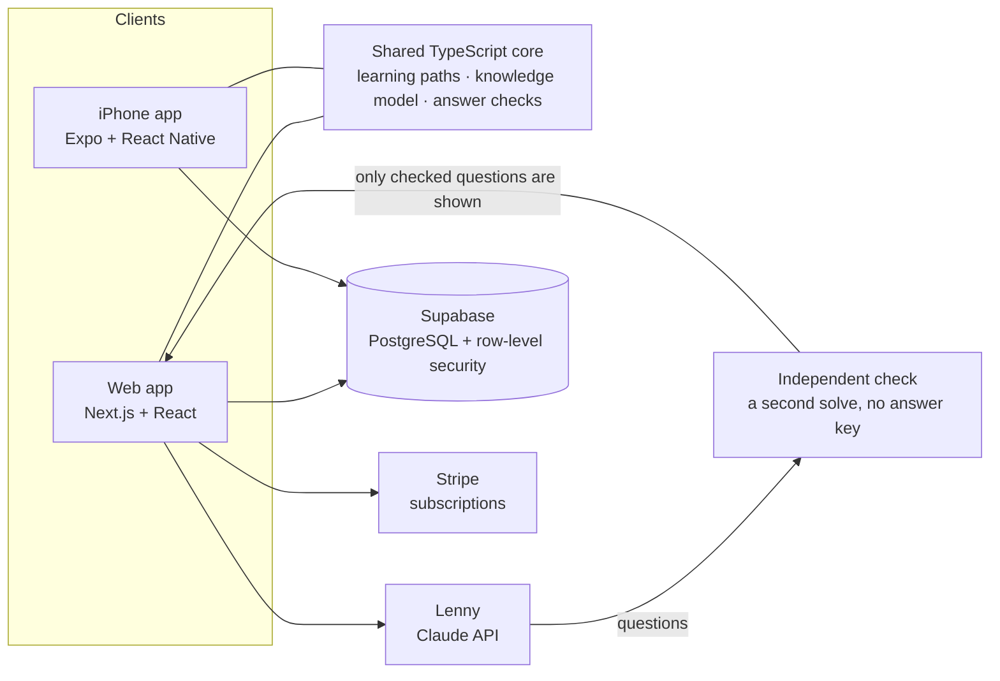
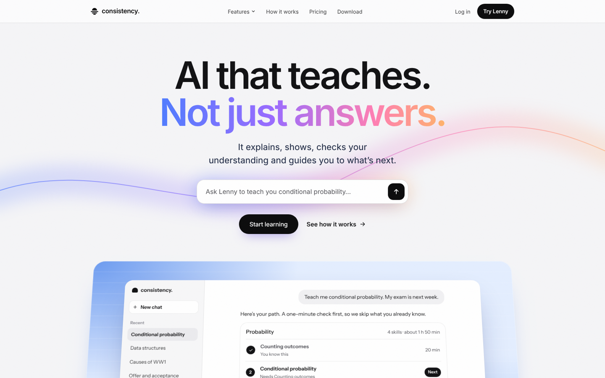

# Consistency

**An AI teacher for uni students. Tell Lenny what you need to learn. It teaches you, step by step.**

[consistencyau.com](https://consistencyau.com) · Web app live since October 2026 · iPhone app coming soon to the App Store in Australia

---

## Why I built it

Consistency started as an AI study planner: Lenny read your unit guides and planned your week. Using it for my own exams, I found the hard part was never the plan. It was sitting down with a unit of lecture slides and not knowing where to start, what I was missing, or whether I had actually understood it.

So I rebuilt it as a teacher. You say what you need to learn, or upload your slides, and Lenny takes it from there: a learning path, a quick check of what you already know, lessons one skill at a time, and questions that test you. A chatbot answers what you ask. Lenny decides what to teach next.

I built it from scratch as the founder and only engineer: product, design, the full stack from the database to the iPhone app, AI teaching and payments.

> **About this repository:** Consistency is a live product, so its source code is private. This page shows what it does and how it is built. I'm happy to walk through the code in an interview.

## What it does

| | |
|---|---|
| **Lenny** | Type what you need ("I need to study FIT2004, my exam is in two weeks") or upload your lecture slides. Lenny builds a learning path right in the chat. A quick question still gets a quick answer. |
| **1-minute check** | A few questions on the first skills, so the path skips what you already know. |
| **Learning path** | Skills in the order they build on each other, each with what you will be able to do and how long it takes. With an exam tomorrow, the path fits the time left and says what it left out. |
| **Lessons** | One skill at a time: an intuition, the real definition, a worked example you step through, the common mistake, then your turn. Ask for it simpler, deeper, another way, or as a graph. |
| **Learning DNA** | What you know, skill by skill, worked out from your own answers: mastery that fades without practice, the mistake you keep making, and the one thing to do next, with the reason. You can correct it. |
| **Practice** | Quick checks, flashcards and mock exams with marking, all on the skills you are learning. |

  
  

## How it is built

- **One teaching core, two apps.** The web app and the iPhone app share one TypeScript core, so a path, a lesson and a mastery estimate are worked out the same way everywhere.
- **Every question is checked before a student sees it.** Deterministic checks run first (the arithmetic in the explanation, the shape of the question). Then a second, independent AI solve answers it without seeing the key. A question that fails either check is held back instead of shown.
- **Graphs you can trust.** Plots are drawn from formulas by the app's own parser, and the tests compare them with hand-calculated values, so a pretty graph can't carry wrong numbers.
- **A knowledge model, not a label.** Each answer updates a per-skill mastery estimate with a forgetting curve. Repeated mistakes are named. Nothing is a permanent label: the student can say "I already know this" or "teach me this again".
- **A teaching benchmark.** 87 scenarios (starting from zero, repeated mistakes, partly right reasoning, uploaded slides, an exam tomorrow) run against the real model, graded by deterministic checks and independent solves, with human review for the rest.
- **Security first.** Every table is protected by PostgreSQL row-level security across 73 versioned migrations, so one student can never read another's data. Privacy and terms acceptance is enforced in the database itself.
- **Tested.** 6,000+ automated tests across the web app, the iPhone app and the database (Vitest, Playwright and phone render tests).

## Tech stack

| Area | Tools |
|---|---|
| Web | TypeScript, Next.js, React, Tailwind CSS |
| iPhone | Expo, React Native, Reanimated, Apple Liquid Glass |
| Backend & data | Supabase, PostgreSQL, row-level security, SQL migrations |
| AI | Claude API (Anthropic), independent answer checking, a teaching benchmark |
| Payments | Stripe subscriptions |
| Hosting & delivery | Vercel, EAS Build, TestFlight |
| Quality | Vitest, Playwright, ESLint, TypeScript strict mode |

  

## Links

- **Product:** [consistencyau.com](https://consistencyau.com)
- **Builder:** Leonard Chee · [Resume website](https://leonard-chee.netlify.app) · [LinkedIn](https://linkedin.com/in/leonard-chee-hao-jie) · leonardcheehj@gmail.com

© 2026 Leonard Chee. Screenshots are from the real app and website, with example content. All rights reserved.
