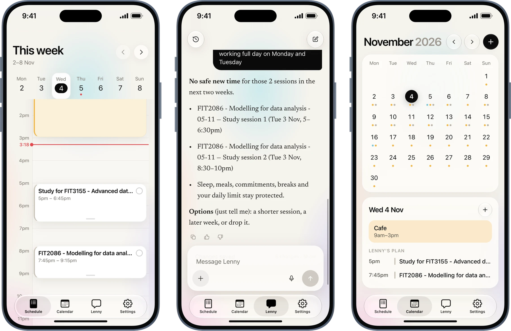
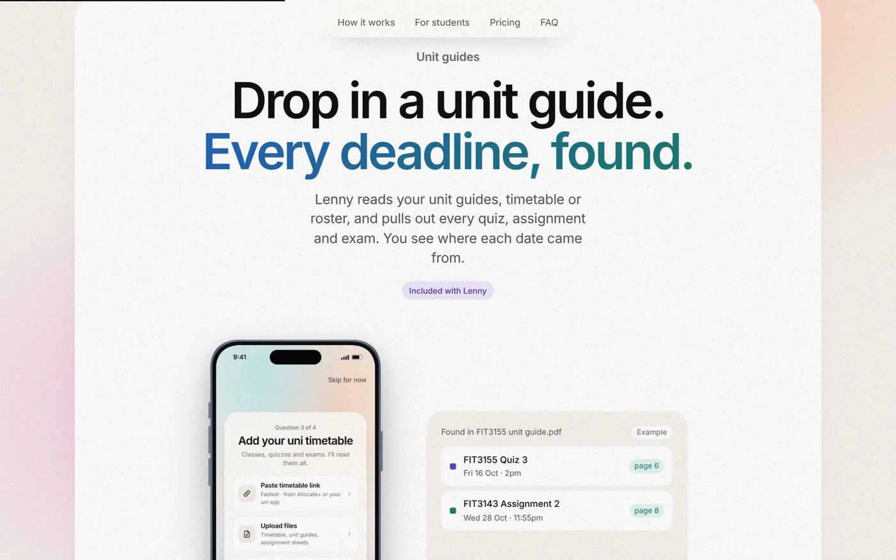
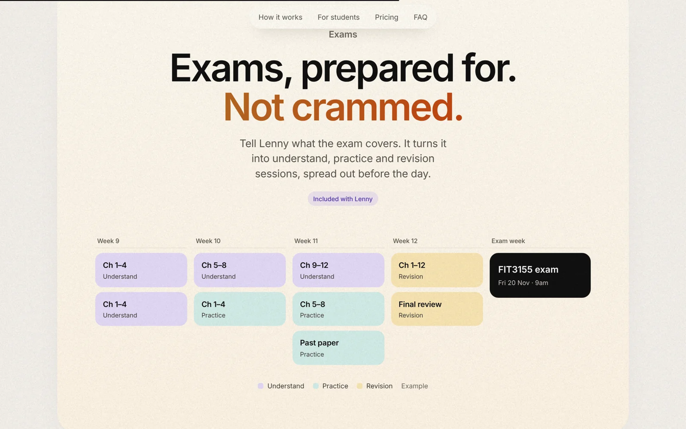
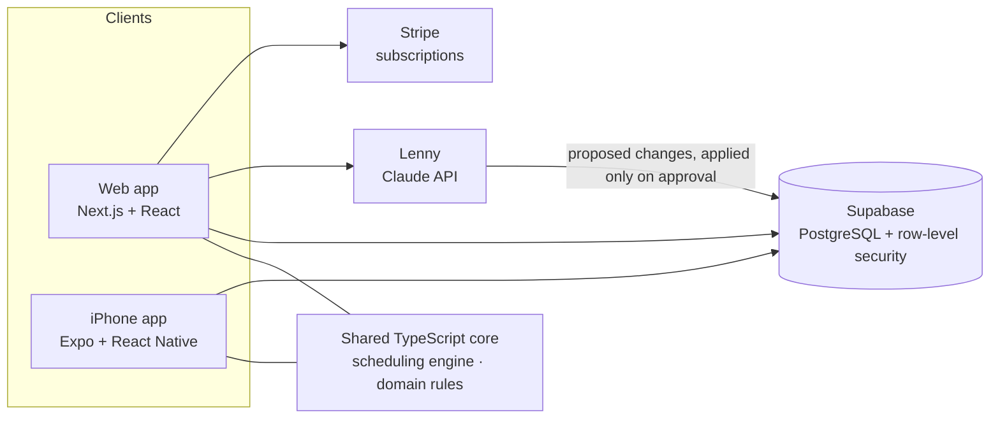
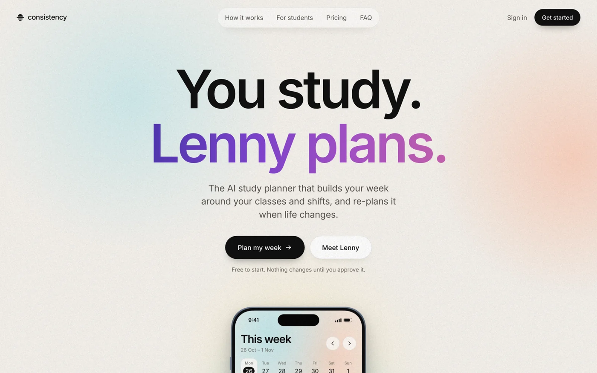

# Consistency

**An AI study planner for uni students. Lenny plans the week. You just study.**

[consistencyau.com](https://consistencyau.com) · Web app live since October 2026 · iPhone app coming soon to the App Store in Australia

---

## Why I built it

I came up with Consistency while struggling to make study plans for myself. With several units, a part-time job and deadlines scattered across unit guides, Moodle and emails, planning a week took hours, and one missed session was enough for the whole plan to fall apart.

So I turned it into a startup. Students upload their unit guides, Lenny finds every deadline and plans study around their classes and shifts. No more draining planning. You just show up.

I built it from scratch over six months as the founder and only engineer: product, design, the full stack from the database to the iPhone app, and payments.

> **About this repository:** Consistency is a live product, so its source code is private. This page shows what it does and how it is built. I'm happy to walk through the code in an interview.

## What it does

| | |
|---|---|
| **Schedule** | The week at a glance. Classes and shifts stay fixed, and Lenny fits study into the free time around them. Tick a session off when it is done. |
| **Lenny, the AI planner** | Chat in plain words ("6pm gym tomorrow", "move my FIT2086 study to Thursday"). Lenny checks the time is free, then adds it or suggests a new plan. When there is no room, it says so and offers options instead of cramming. |
| **Unit guides** | Upload a unit guide (PDF, image, Word or Excel) and Lenny pulls out every quiz, assignment and exam, with the page it came from. |
| **Exams** | Add an exam date and preparation builds up over the weeks before, so nothing is crammed into the last night. |
| **Calendar** | The whole month, with your events and the study Lenny planned for each day. |
| **You stay in control** | Every change Lenny suggests is a review card. Nothing touches the timetable until the student approves it, and every change can be undone. |

  
  

## How it is built

- **One planning core, two apps.** The web app and the iPhone app share one TypeScript core, so a plan is calculated the same way everywhere.
- **The scheduling engine** fits study around classes, work shifts, meals and sleep, keeps each day under a study limit, builds exam preparation up as the date gets closer, and moves a missed session to the next free slot. Pace settings (Chill, Normal, Hardcore) change how full a week is allowed to get.
- **Lenny** runs on the Claude API. It reads uploaded files, turns plain requests into checked changes, and returns them as review cards. Approval is recorded server-side, so an unapproved change can never land.
- **Security first.** Every table is protected by PostgreSQL row-level security across 70 versioned migrations, so one student can never read another's data. Privacy and terms acceptance is enforced in the database itself.
- **Tested.** 5,000+ automated tests across the web app, the iPhone app and the database (Vitest, Playwright and phone render tests).

## Tech stack

| Area | Tools |
|---|---|
| Web | TypeScript, Next.js, React, Tailwind CSS |
| iPhone | Expo, React Native, Reanimated, Apple Liquid Glass |
| Backend & data | Supabase, PostgreSQL, row-level security, SQL migrations |
| AI | Claude API (Anthropic) |
| Payments | Stripe subscriptions |
| Hosting & delivery | Vercel, EAS Build, TestFlight |
| Quality | Vitest, Playwright, ESLint, TypeScript strict mode |

  

## Links

- **Product:** [consistencyau.com](https://consistencyau.com)
- **Builder:** Leonard Chee · [Resume website](https://leonard-chee.netlify.app) · [LinkedIn](https://linkedin.com/in/leonard-chee-hao-jie) · leonardcheehj@gmail.com

© 2026 Leonard Chee. Screenshots are from the real app and website. All rights reserved.
